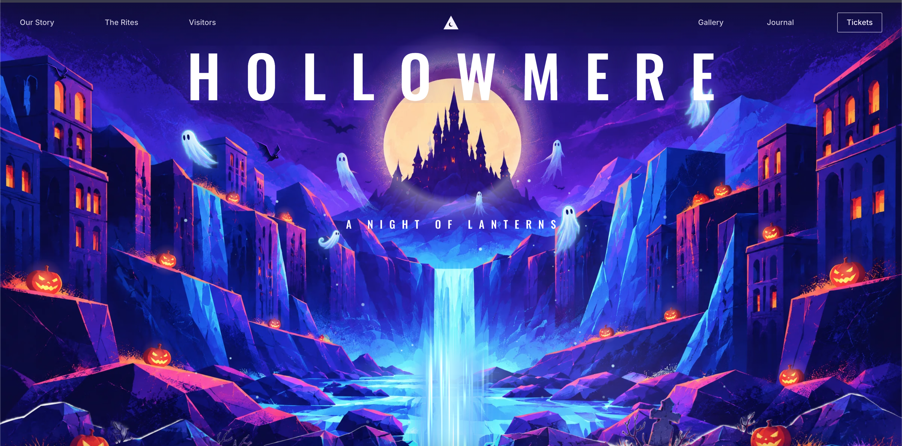

<div align="center">
  <h1>Hollowcreative</h1>
  <p>A modern, creative web experience built with TypeScript, React, and Vite.</p>
  
  <p>
    <a href="https://hollowcreative.vercel.app/" target="_blank"><strong>🌐 Live Demo</strong></a>
  </p>
</div>

<br />

<!-- اسحب صورة السكرين شوت وأفلتها هنا ليقوم GitHub برفعها تلقائياً -->
<div align="center">
  
</div>

---

##  Features

* **Modern UI/UX:** Clean, responsive, and interactive design tailored for creative showcases.
* **Fast Performance:** Powered by Vite for instant server start and lightning-fast HMR.
* **Type-Safe Codebase:** Built entirely with TypeScript for reliability and maintainability.
* **Custom Typography:** Styled with custom local fonts for a distinct visual identity.

##  Tech Stack

* **Frontend:** React, TypeScript
* **Styling:** CSS3
* **Build Tool:** Vite
* **Deployment:** Vercel

##  Getting Started

Follow these steps to run the project locally on your machine:

### Prerequisites

* **Node.js** (v18 or higher recommended)

### Installation

1. **Clone the repository:**
   ```bash
   git clone [https://github.com/yehia-hossam/Hollowcreative.git](https://github.com/yehia-hossam/Hollowcreative.git)
   cd Hollowcreative
